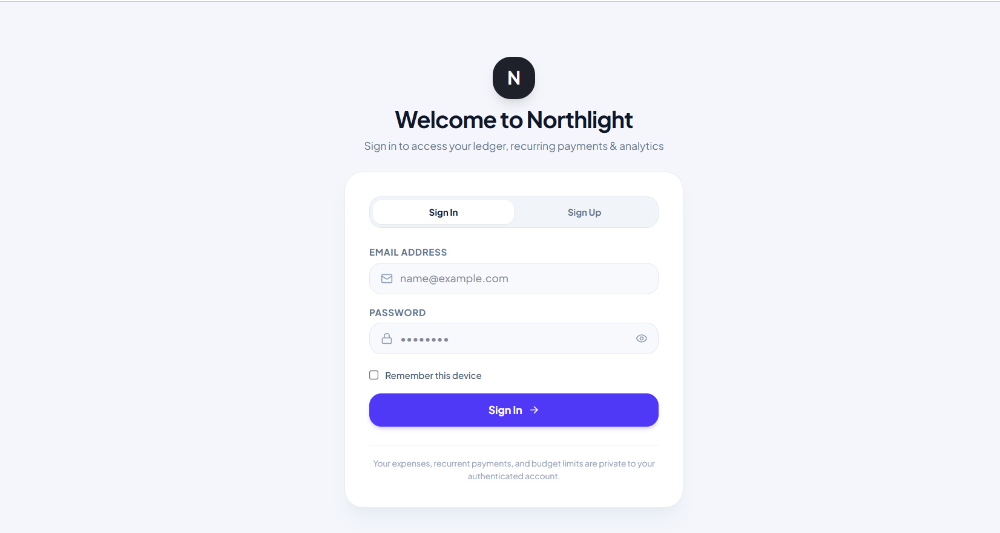
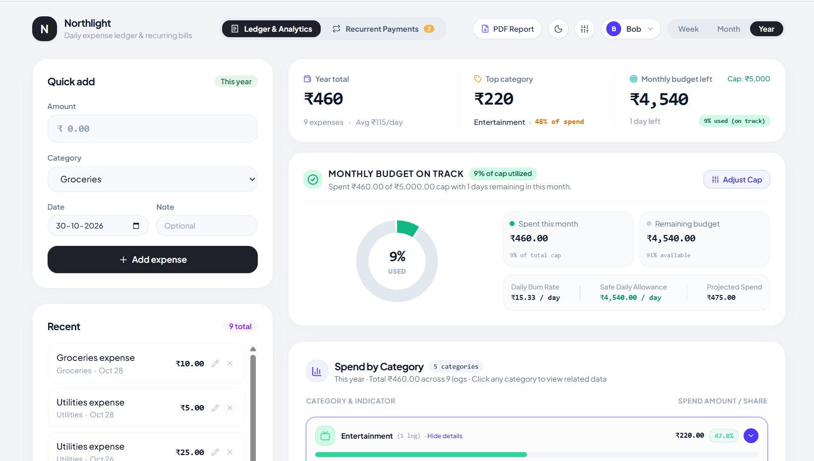
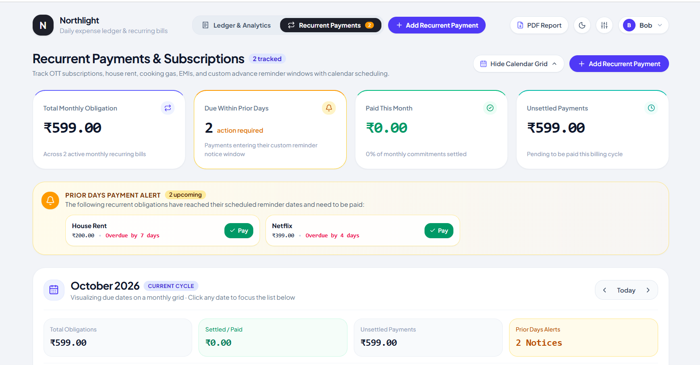
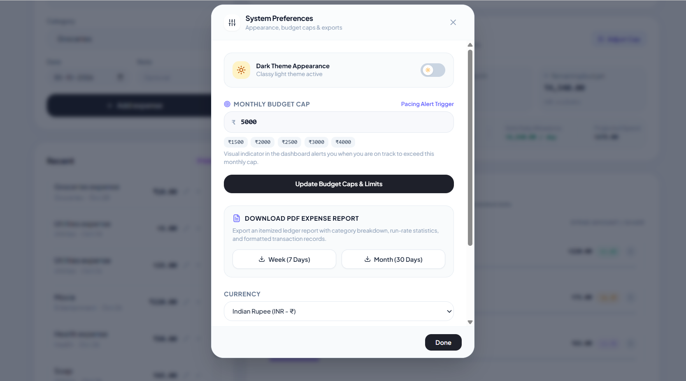
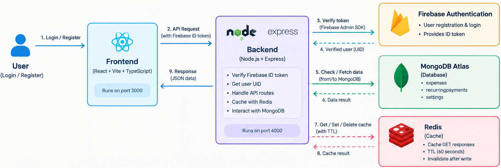

# DailySpend — Expense Tracking Application

Expense tracking application that helps users manage daily expenses, recurring payments, budgets.

It uses Firebase Authentication for user authentication, Node.js and Express for backend API services, MongoDB Atlas for persistent data storage, and Redis for caching frequently accessed data. The application is containerized using Docker Compose to simplify local development and service management.

### Key Objectives
- Firebase Authentication with backend token verification.
- Store user-specific expense data in MongoDB Atlas.
- Introduce Redis caching with a time-to-live (TTL).
- Implement cache invalidation after successful data modifications.
- Containerize the application using Docker.
- Understand the interaction between frontend, backend, authentication, database, and caching services.

---

## 🖼️ Application Screenshots

Add your application PNG screenshots to the `docs/images/` directory.

The following image references are placeholders. Replace the filenames with the actual names of your screenshots.

### Login Page



### Dashboard



### Recurring Payments



### Budget and Settings



---

## 🏗️ System Architecture

DailySpend follows a client-server architecture with separate frontend and backend services.

The backend communicates with Firebase Authentication, MongoDB Atlas, and Redis.



---

## 🛠️ Technology Stack

### Architecture Components

| Component | Responsibility |
|---|---|
| React Frontend | User interface, authentication flow, expense management, and API requests |
| Node.js | Backend JavaScript runtime |
| Express.js | REST API routes and request handling |
| Firebase Authentication | User registration, login, and ID token generation |
| Firebase Admin SDK | Verification of Firebase ID tokens in the backend |
| MongoDB Atlas | Persistent storage for expenses, recurring payments, and settings |
| Redis | Caching frequently accessed API responses |
| Docker | Containerization of application services |
| Docker Compose | Local orchestration of frontend, backend, and Redis |


---

## 📁 Project Structure

The project is organized into separate frontend and backend directories.

```text
DailySpend/
│
├── frontend/
│   └── src/
│       ├── components/ # Reusable UI components
│       ├── pages/      # Application Pages
│       └── utils/      # Utility functions   
│       └── firebase-applet-config.json  # Firebase Web configuration values.
│
└── backend/
    └── src/
    │   ├── server.ts      # Express server and API routes
    │   ├── db.ts          # MongoDB operations
    │   ├── redis.ts       # Redis connection and cache helpers
    │   └── cacheKeys.ts   # Redis cache Key definitions
    │
    ├── .env
    └── firebase-service-account.json
```

---
## 🔌 API Endpoints

All expense, recurring-payment, and settings endpoints require Firebase authentication.


### Expenses

| Method | Endpoint | Description |
|---|---|---|
| GET | `/api/expenses` | Retrieve authenticated user's expenses |
| POST | `/api/expenses` | Create an expense |
| PUT | `/api/expenses/:id` | Update an expense |
| DELETE | `/api/expenses/:id` | Delete an expense |

### Recurring Payments

| Method | Endpoint | Description |
|---|---|---|
| GET | `/api/recurring` | Retrieve recurring payments |
| POST | `/api/recurring` | Create a recurring payment |
| PUT | `/api/recurring/:id` | Update a recurring payment |
| DELETE | `/api/recurring/:id` | Delete a recurring payment |

### Settings

| Method | Endpoint | Description |
|---|---|---|
| GET | `/api/settings` | Retrieve settings |
| PUT | `/api/settings` | Save or update settings |
| POST | `/api/settings` | Save settings |

The GET endpoints for expenses, recurring payments, and settings use Redis caching.

---

## ⚙️ Getting Started


### Clone the Repository

```bash
git clone https://github.com/YOUR_USERNAME/DailySpend.git
```

### Configure Firebase

1. Create a Firebase project.
2. Enable Firebase Authentication.
3. Configure the required sign-in method.
4. Configure the Firebase frontend application.
5. Generate a Firebase Admin service-account key.
6. Place the service-account JSON file in the backend directory.

The service-account file should be available locally at:

The backend uses the Firebase Admin SDK to verify Firebase ID tokens received from the frontend.

```text
backend/firebase-service-account.json
```
---

## 🔐 Environment Configuration

Create a backend `.env` file.

Example:

```env
PORT=4000

FRONTEND_URL=http://localhost:3000

MONGODB_URI=YOUR_MONGODB_ATLAS_CONNECTION_STRING

FIREBASE_SERVICE_ACCOUNT_PATH=/run/secrets/firebase-service-account.json

REDIS_URL=redis://redis:6379
```

| Variable | Description |
|---|---|
| `PORT` | Port on which the Express backend runs |
| `FRONTEND_URL` | Frontend origin allowed by the backend CORS configuration |
| `MONGODB_URI` | MongoDB Atlas connection string |
| `FIREBASE_SERVICE_ACCOUNT_PATH` | Path to the Firebase Admin service-account JSON file |
| `REDIS_URL` | Redis connection URL |

> Replace the MongoDB environment variable name with the exact name used in your `db.ts` implementation if it differs.

For Docker Compose, the Redis hostname is `redis`, because Redis is another service on the Compose network.

When running the backend directly on the host machine, the Redis URL would typically be:

```env
REDIS_URL=redis://127.0.0.1:6379
```

The frontend Firebase configuration should be supplied using the environment variables expected by the frontend application.

---

## 🐳 Docker Setup

DailySpend uses Docker Compose to run the frontend, backend, and Redis services.

### Services

| Service | Container | Port |
|---|---|---|
| Frontend | `dailyspend-frontend` | `3000` |
| Backend | `dailyspend-backend` | `4000` |
| Redis | `dailyspend-redis` | `6379` |

MongoDB Atlas runs externally as a cloud database.

---

## 🔮 Future Improvements

Potential enhancements for future development:

- Deploy the application using a cloud hosting platform.
- Configure production environment variables and secrets.
- Add Redis-based rate limiting.
- Introduce background jobs for recurring payment processing.
- Add CI/CD workflows using GitHub Actions.
- Add application logging and performance monitoring.

These are future improvements and are not all part of the current implementation.

---

## ⭐ Project Summary

DailySpend is a expense tracking application built using React, Node.js, Express, Firebase Authentication, MongoDB Atlas, Redis, and Docker.

The project demonstrates:

- Full-stack application development.
- Authentication and protected REST APIs.
- User-specific persistent data storage.
- Redis cache-aside implementation.
- TTL-based cache expiration.
- Cache invalidation after database writes.
- Docker containerization and service orchestration.

MongoDB Atlas remains the source of truth, while Redis improves the efficiency of repeated data retrieval.

